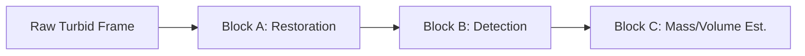

# HydroTrashVision

Computer vision and AI pipeline for detecting, restoring, and quantifying
plastic debris in underwater and river footage.

## Problem & Motivation

Plastic pollution in rivers and coastal waters is difficult to monitor at
scale using manual methods. This project explores a low-cost, camera-based
pipeline that could support environmental monitoring efforts aligned with
UN Sustainable Development Goals (clean water, life below water).

HydroTrashVision is a deliberate spin-off from a larger autonomous
underwater robot project. Rather than waiting on the physical robot, the
computer vision and AI component is isolated here as a self-contained,
demonstrable system — buildable and testable with public datasets alone.

## Pipeline Overview

The full pipeline takes a raw, turbid underwater video frame and produces:

1. **Restored image** — corrected for turbidity and color distortion (Block A)
2. **Detections** — class, bounding box, confidence for each debris object (Block B)
3. **Estimated mass/volume** per detected object (Block C)

Each stage is validated with a documented numerical metric, not qualitative
assessment.



**Current status**: Block A (restoration) is complete. Block B (detection) is in progress — pipeline and training script verified, full training run pending. Blocks C and D are planned.

## Architecture

### Block A — Image Restoration

**Classical baseline** (complete, formally measured):
1. `gray_world_white_balance` — corrects color cast from selective light absorption in water
2. `clahe_per_channel` — local contrast enhancement in LAB space
3. `underwater_dark_channel_prior` — haze/turbidity removal, with a guided filter refining the transmission map

**Deep learning** (in progress), planned in order of increasing complexity:
1. Simple CNN encoder-decoder — complete, trained (50 epochs), evaluated.
   Substantial and consistent improvement over classical baseline (see Results).
2. Domain-specific architecture (UWCNN or WaterNet) — optional extension,
   not required for Block A closure; may be pursued as capacity allows.
3. GAN (FUnIE-GAN) — deprioritized given (1) already meets the comparison
   objective; literature reports texture artifacts in GAN-based methods
   relative to CNN hybrids.

## Results

### Classical baseline — Full-reference metrics (PSNR / SSIM)

| Dataset | n | PSNR (mean ± std) | SSIM (mean ± std) |
|---|---|---|---|
| UIEB | 890 | 12.74 ± 2.90 | 0.6372 ± 0.1461 |
| EUVP-underwater_imagenet | 3700 | 15.35 ± 2.23 | 0.6110 ± 0.0795 |
| EUVP-underwater_scenes | 2185 | 14.45 ± 2.56 | 0.5905 ± 0.1031 |
| EUVP-underwater_dark | 5550 | 14.93 ± 2.12 | 0.6768 ± 0.1042 |
| **Overall (paired)** | 12325 | 14.81 ± 2.39 | 0.6389 ± 0.1073 |

### Deep learning (CNN encoder-decoder) — Full-reference metrics

Trained 50 epochs on Kaggle (Tesla T4), evaluated strictly on the held-out
test split (n=1233, never seen during training).

| Dataset | n | PSNR (mean ± std) | SSIM (mean ± std) |
|---|---|---|---|
| UIEB | 89 | 18.95 ± 3.41 | 0.8271 ± 0.1065 |
| EUVP-underwater_imagenet | 370 | 23.96 ± 2.31 | 0.8316 ± 0.0566 |
| EUVP-underwater_scenes | 219 | 26.82 ± 2.36 | 0.8746 ± 0.0497 |
| EUVP-underwater_dark | 555 | 22.57 ± 3.84 | 0.9004 ± 0.0724 |
| **Overall (test split)** | 1233 | 23.48 ± 3.74 | 0.8699 ± 0.0746 |

### Classical vs. CNN comparison

| Method | n | PSNR (mean ± std) | SSIM (mean ± std) |
|---|---|---|---|
| Classical (UDCP) | 12325 | 14.81 ± 2.39 | 0.6389 ± 0.1073 |
| CNN simple (test split only) | 1233 | 23.48 ± 3.74 | 0.8699 ± 0.0746 |

The CNN shows a substantial and consistent improvement (+8.67 dB PSNR,
+0.231 SSIM) across all four sub-datasets, with no dataset lagging behind.
Note the coverage difference: the classical baseline is measured on 100% of
the paired data, while the CNN is measured only on its held-out test split
(a strict subset of that same data) — this is the correct comparison, since
reporting the CNN on data it trained on would be misleading. Given this
result, Block A restoration is closed with these two methods (classical +
CNN); domain-specific architectures (UWCNN/WaterNet) were not pursued
further, as the CNN already showed clear, consistent improvement over the
classical baseline.

### Classical baseline — No-reference metrics (UIQM / UCIQE)

| Dataset | n | UIQM (mean ± std) | UCIQE (mean ± std) |
|---|---|---|---|
| RUIE-A | 726 | 3.7043 ± 0.3683 | 65.19 ± 7.00 |
| RUIE-B | 726 | 3.7892 ± 0.4659 | 56.95 ± 6.35 |
| RUIE-C | 726 | 3.9786 ± 0.5844 | 54.30 ± 7.41 |
| RUIE-D | 726 | 4.5576 ± 0.7842 | 49.13 ± 7.61 |
| RUIE-E | 726 | 4.6304 ± 0.8704 | 50.55 ± 7.90 |

### Known limitations (documented with evidence, see `vision/docs/metrics_log.md`)

- The classical UDCP method shows block-pattern artifacts in images with
  strong color imbalance combined with low-amplitude source JPEG
  compression, amplified by white balance gain and the dehazing
  reconstruction's division step.
- Large, uniformly-textured bright regions (sand, open water) violate the
  Dark Channel Prior's core assumption, a known limitation of DCP-based
  methods in general.
- UIQM shows a monotonic order inversion across RUIE's A-E quality labels,
  consistent with documented sensitivity of its sub-metrics to color cast
  and noise (Li & Cavallaro, ICIP 2022, arXiv:2207.05470). UCIQE tracks
  the expected order but is not perfectly monotonic at the low-quality end.

Both restoration artifacts motivate the move to deep learning; the UIQM
finding is a metric-reliability caveat, not a restoration defect.

## Datasets Used

| Dataset | Role | Size | License / Attribution |
|---|---|---|---|
| [UIEB](https://li-chongyi.github.io/proj_benchmark.html) | Block A, PSNR/SSIM | 890 pairs | Academic use |
| [EUVP](http://irvlab.cs.umn.edu/resources/euvp-dataset) | Block A, PSNR/SSIM | 12,000+ pairs | Academic use |
| [RUIE](https://github.com/dlut-dimt/Realworld-Underwater-Image-Enhancement-RUIE-Benchmark) | Block A, no-reference eval | ~3,930 images | Academic / non-commercial use |
| [RiSID](https://doi.org/10.5281/zenodo.15533743) | Block B, detection | — | CC BY 4.0 (Kataoka, Yoshida & Yamamoto, 2025) — requires attribution |
| [TrashCan](https://conservancy.umn.edu/handle/11299/214865) | Block B, detection | 6,008 train / 1,204 val images (Material version) | Free for academic/research use; JAMSTEC permission required for commercial use (Hong, Fulton & Sattar, 2020) |
| [WPBB](https://github.com/fedezocco/MoreEffEffDetsAndWPBB-TensorFlow/tree/main/WPBB_dataset) | Block B, detection | 900 images (720 train / 180 val) | No explicit license published; released publicly by Van (2022) alongside the associated paper |

Datasets are not included in this repository due to size and licensing;
see `vision/data/public_datasets/` structure below for how to place them
locally.

## How to Reproduce

Requires **Python 3.10** (pinned, not 3.10+) — required for NVIDIA Jetson
JetPack 6.x / PyTorch `cp310` wheel compatibility, needed for future
deployment to embedded hardware.

```bash
git clone <repo-url>
cd hydro-trash-vision
python3.10 -m venv venv
source venv/bin/activate
pip install -r requirements.txt
```

Place the datasets under `vision/data/public_datasets/` following this structure:

```
UIEB/raw-890/, UIEB/reference-890/
EUVP/Paired/<scene>/trainA/, trainB/   (scenes: underwater_imagenet, underwater_scenes, underwater_dark)
RUIE/UIQS/<A-E>/
```

Run the classical baseline evaluation:

```bash
python vision/src/restoration/evaluate_restoration.py
```

Generates `vision/docs/metrics_log.md` with PSNR/SSIM and UIQM/UCIQE results.

Generate the train/val/test split and train the CNN baseline:

```bash
python vision/src/restoration/dataset.py
python vision/src/restoration/train_restoration.py
```

Evaluate the trained CNN on the held-out test split:

```bash
python vision/src/restoration/evaluate_deep_model.py
```

For Block B (detection), place TrashCan, RiSID, and WPBB under
`vision/data/public_datasets/`, then convert annotations to a unified
YOLO-format dataset:

```bash
python vision/src/detection/convert_annotations.py
```

Run a quick local smoke test of the detection training script (CPU, small
fraction of data, 2 epochs):

```bash
python vision/src/detection/train_yolo.py
```

## Project Status

- [x] Classical restoration baseline implemented and formally measured
- [x] Deep learning restoration (simple CNN encoder-decoder) — trained and evaluated; classical vs. CNN comparison complete
- [ ] (optional) Domain-specific restoration architecture (UWCNN/WaterNet) — stretch goal
- [ ] Detection (YOLO26 vs. YOLOv8) on TrashCan/RiSID/WPBB
  - [x] Unified 9-class scheme defined and closed
  - [x] Annotation conversion to YOLO format (COCO + PASCAL VOC sources)
  - [x] Training script with weighted oversampling for class imbalance, verified via smoke test
  - [ ] Full training run and real comparison results
- [ ] Mass/volume estimation with underwater camera calibration
- [ ] Full-pipeline latency and resource benchmarking
- [x] Modular repository structure, frozen `requirements.txt`

## Author

Noe Monsivais
