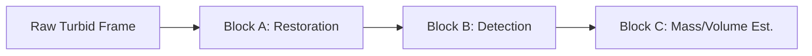

# HydroTrashVision

Modular computer vision and AI pipeline for restoring underwater and river
imagery, detecting aquatic debris, and developing physically calibrated
mass estimation capabilities.

## Problem & Motivation

Plastic pollution in rivers and coastal waters is difficult to monitor at
scale using manual methods. This project explores a low-cost, camera-based
pipeline that could support environmental monitoring efforts aligned with
UN Sustainable Development Goals (clean water, life below water).

HydroTrashVision is a deliberate spin-off from a larger autonomous
underwater robot project. Rather than waiting on the physical robot, the
computer vision and AI component is isolated here as a self-contained,
demonstrable system — buildable and testable with public datasets alone.

## Pipeline Overview

The target pipeline processes underwater or river imagery through three
coordinated stages:

1. **Image restoration (Block A)** — optional enhancement of underwater
   imagery to address color degradation, contrast loss, and turbidity.
2. **Object detection (Block B)** — identification of objects using the
   project's unified nine-class scheme, returning bounding boxes and
   confidence scores.
3. **Mass estimation (Block C)** — per-object mass estimation based on
   physically justified calibration, with explicit status reporting
   when an estimate cannot be produced.

The shared data contracts and modular pipeline coordinator are already
implemented. However, the complete inference workflow using trained
detection models and calibrated mass estimation is not yet operational.

Mass estimation currently supports three explicit result states:
`unavailable`, `uncalibrated`, and `estimated`. A numerical mass
estimate requires valid physical calibration; the pipeline must not
report unsupported mass values.

The `rov` class represents the underwater vehicle and is not treated
as waste for mass estimation.



**Current status:** Block A restoration algorithms have been implemented
and experimentally evaluated, and classical/CNN inference adapters are
available. Block B training and architecture comparison are complete,
with YOLOv8s selected as the current detection baseline; its inference
adapter and real-model pipeline integration remain pending.

The modular coordinator and restoration adapters have passed 134
combined contract, unit, and integration test cases. These tests
primarily validate interfaces and deterministic behavior, not the
end-to-end performance of the trained models.

Block C physical mass estimation and Block D full-pipeline benchmarking
remain pending.

## Architecture

### Modular Inference Architecture

HydroTrashVision uses a modular, dependency-injected inference
architecture to separate data validation, execution coordination,
and model-specific processing.

The current implementation consists of three main components:

- `vision/src/core/contracts.py` — defines validated data contracts
  (`FramePacket`, `Detection`, `MassEstimate`, and `FrameResult`).
- `vision/src/pipeline.py` — coordinates restoration, detection, and
  per-object mass estimation through lightweight `Protocol` interfaces.
- `vision/src/restoration/inference.py` — implements classical and CNN
  restoration adapters compatible with the coordinator.

The coordinator defines three component interfaces:

- `Restorer.restore(image)` — optionally restores an image.
- `Detector.detect(image)` — returns validated object detections.
- `MassEstimator.estimate(detection, frame)` — returns a mass estimate
  or an explicit reason why estimation is unavailable.

Restoration is optional. Passing `restorer=None` activates identity
restoration, preserving the original image without applying an
enhancement algorithm.

All external pipeline images use BGR channel order, `uint8` data type,
and `(height, width, 3)` dimensions. Restored images must preserve
the original frame dimensions, and detections use original-frame
coordinates.

The coordinator records restoration, detection, mass estimation,
and total processing times in milliseconds.

#### Restoration Inference Adapters

Two concrete restoration adapters are currently available:

- `ClassicalRestorer` — reuses the existing classical restoration
  pipeline without duplicating its algorithms.
- `CNNRestorer` — loads a CNN model, converts BGR images into normalized
  RGB tensors, performs gradient-free inference, and converts outputs
  back into BGR `uint8` images.

The CNN adapter preserves image geometry by applying edge padding
to the next multiple of eight and cropping the restored output back
to its original dimensions.

The CNN was trained using 256 x 256 images. Although the adapter
supports other input dimensions, restoration quality at arbitrary
resolutions has not yet been experimentally validated.

#### Integration Status

The coordinator and restoration adapters have been validated using
deterministic test doubles, including simulated detection and mass
estimation components.

A concrete YOLOv8s inference adapter and a physically calibrated
mass estimator are not yet integrated. Therefore, the current
implementation should not be considered a fully validated
end-to-end inference system.

### Block A — Image Restoration

**Classical baseline** (complete, formally measured):
1. `gray_world_white_balance` — corrects color cast from selective light absorption in water
2. `clahe_per_channel` — local contrast enhancement in LAB space
3. `underwater_dark_channel_prior` — haze/turbidity removal, with a guided filter refining the transmission map

**Deep learning** (CNN completed; optional extensions listed below):
1. Simple CNN encoder-decoder — complete, trained (50 epochs), evaluated.
   Substantial and consistent improvement over classical baseline (see Results).
2. Domain-specific architecture (UWCNN or WaterNet) — optional extension,
   not required for Block A closure; may be pursued as capacity allows.
3. GAN (FUnIE-GAN) — deprioritized given (1) already meets the comparison
   objective; literature reports texture artifacts in GAN-based methods
   relative to CNN hybrids.

### Block B — Object Detection

Two detection architectures are being evaluated: YOLOv8s and YOLO26s, using a unified nine-class dataset built from TrashCan-Material, RiSID, and WPBB.

The initial training experiment compared both small (`s`) model variants over 70 epochs. Weighted oversampling was used to mitigate class imbalance.

YOLOv8s achieved the best overall detection metrics and has been selected as the current baseline for further development.

Block B remains under active development. Additional evaluation will focus on the low recall of `trash_plastic`, dataset-source differences, object scale, and potential model improvements.

## Results

### Classical baseline — Full-reference metrics (PSNR / SSIM)

| Dataset | n | PSNR (mean ± std) | SSIM (mean ± std) |
|---|---|---|---|
| UIEB | 890 | 12.74 ± 2.90 | 0.6372 ± 0.1461 |
| EUVP-underwater_imagenet | 3700 | 15.35 ± 2.23 | 0.6110 ± 0.0795 |
| EUVP-underwater_scenes | 2185 | 14.45 ± 2.56 | 0.5905 ± 0.1031 |
| EUVP-underwater_dark | 5550 | 14.93 ± 2.12 | 0.6768 ± 0.1042 |
| **Overall (paired)** | 12325 | 14.81 ± 2.39 | 0.6389 ± 0.1073 |

### Deep learning (CNN encoder-decoder) — Full-reference metrics

Trained 50 epochs on Kaggle (Tesla T4), evaluated strictly on the held-out
test split (n=1233, never seen during training).

| Dataset | n | PSNR (mean ± std) | SSIM (mean ± std) |
|---|---|---|---|
| UIEB | 89 | 18.95 ± 3.41 | 0.8271 ± 0.1065 |
| EUVP-underwater_imagenet | 370 | 23.96 ± 2.31 | 0.8316 ± 0.0566 |
| EUVP-underwater_scenes | 219 | 26.82 ± 2.36 | 0.8746 ± 0.0497 |
| EUVP-underwater_dark | 555 | 22.57 ± 3.84 | 0.9004 ± 0.0724 |
| **Overall (test split)** | 1233 | 23.48 ± 3.74 | 0.8699 ± 0.0746 |

### Classical vs. CNN comparison

| Method | n | PSNR (mean ± std) | SSIM (mean ± std) |
|---|---|---|---|
| Classical (UDCP) | 12325 | 14.81 ± 2.39 | 0.6389 ± 0.1073 |
| CNN simple (test split only) | 1233 | 23.48 ± 3.74 | 0.8699 ± 0.0746 |

The reported aggregate metrics favor the CNN across all four evaluated
datasets. The overall differences are +8.67 dB PSNR and +0.231 SSIM.
However, these values describe differences between aggregate results
computed on different image subsets, not strictly paired improvements.

The classical baseline was evaluated on all 12,325 paired images,
whereas the CNN was evaluated on its held-out test split of 1,233
images, which were not used during training. A rigorous paired
comparison would require evaluating both methods on the same images.

Based on the available experimental evidence, Block A restoration
is considered closed with the classical baseline and the CNN.
Domain-specific architectures (UWCNN/WaterNet) were not pursued
further, although additional validation may be warranted under
real deployment conditions.

### Classical baseline — No-reference metrics (UIQM / UCIQE)

| Dataset | n | UIQM (mean ± std) | UCIQE (mean ± std) |
|---|---|---|---|
| RUIE-A | 726 | 3.7043 ± 0.3683 | 65.19 ± 7.00 |
| RUIE-B | 726 | 3.7892 ± 0.4659 | 56.95 ± 6.35 |
| RUIE-C | 726 | 3.9786 ± 0.5844 | 54.30 ± 7.41 |
| RUIE-D | 726 | 4.5576 ± 0.7842 | 49.13 ± 7.61 |
| RUIE-E | 726 | 4.6304 ± 0.8704 | 50.55 ± 7.90 |

### Object Detection — Initial YOLO Architecture Comparison

YOLOv8s and YOLO26s were trained for 70 epochs on the unified nine-class detection dataset using Kaggle (NVIDIA Tesla T4).

| Model | Epochs | mAP50 | mAP50-95 |
|---|---:|---:|---:|
| **YOLOv8s** | 70 | **0.4782** | **0.3363** |
| YOLO26s | 70 | 0.4106 | 0.2210 |

YOLOv8s outperformed YOLO26s on both reported metrics and was selected as the current detection baseline.

However, the initial evaluation revealed a significant limitation in the detection of `trash_plastic`, despite this class representing approximately 59% of all annotated instances.

The diagnostic investigation identified a high proportion of missed plastic detections, particularly associated with small objects and the elevated river-surface imagery in RiSID.

These findings motivate further evaluation and targeted improvements before considering Block B complete. Detailed results and diagnostic findings are documented in `vision/docs/metrics_log.md`.

### Known limitations (documented with evidence, see `vision/docs/metrics_log.md`)

- The classical UDCP method shows block-pattern artifacts in images with
  strong color imbalance combined with low-amplitude source JPEG
  compression, amplified by white balance gain and the dehazing
  reconstruction's division step.
- Large, uniformly-textured bright regions (sand, open water) violate the
  Dark Channel Prior's core assumption, a known limitation of DCP-based
  methods in general.
- UIQM shows a monotonic order inversion across RUIE's A-E quality labels,
  consistent with documented sensitivity of its sub-metrics to color cast
  and noise (Li & Cavallaro, ICIP 2022, arXiv:2207.05470). UCIQE tracks
  the expected order but is not perfectly monotonic at the low-quality end.

Both restoration artifacts motivate the move to deep learning; the UIQM
finding is a metric-reliability caveat, not a restoration defect.

**Detection limitations (Block B):**

- `trash_plastic` exhibited low detection performance (AP = 0.2513) despite being the most represented class in the training datasets.
- Diagnostic analysis showed that approximately 71% of plastic instances were predicted as background, indicating a predominantly missed-detection problem.
- Plastic objects have substantially smaller median bounding-box areas than other classes, and a large proportion originate from RiSID's elevated river-surface imagery.
- The extent to which these limitations affect close-range underwater detection remains to be experimentally verified.

Further evaluation is planned before determining whether changes to training, data sampling, input resolution, or model architecture are justified.

## Datasets Used

| Dataset | Role | Size | License / Attribution |
|---|---|---|---|
| [UIEB](https://li-chongyi.github.io/proj_benchmark.html) | Block A, PSNR/SSIM | 890 pairs | Academic use |
| [EUVP](http://irvlab.cs.umn.edu/resources/euvp-dataset) | Block A, PSNR/SSIM | 12,000+ pairs | Academic use |
| [RUIE](https://github.com/dlut-dimt/Realworld-Underwater-Image-Enhancement-RUIE-Benchmark) | Block A, no-reference eval | ~3,930 images | Academic / non-commercial use |
| [RiSID](https://doi.org/10.5281/zenodo.15533743) | Block B, detection | — | CC BY 4.0 (Kataoka, Yoshida & Yamamoto, 2025) — requires attribution |
| [TrashCan](https://conservancy.umn.edu/handle/11299/214865) | Block B, detection | 6,008 train / 1,204 val images (Material version) | Free for academic/research use; JAMSTEC permission required for commercial use (Hong, Fulton & Sattar, 2020) |
| [WPBB](https://github.com/fedezocco/MoreEffEffDetsAndWPBB-TensorFlow/tree/main/WPBB_dataset) | Block B, detection | 900 images (720 train / 180 val) | No explicit license published; released publicly by Van (2022) alongside the associated paper |

Datasets are not included in this repository due to size and licensing;
see `vision/data/public_datasets/` structure below for how to place them
locally.

## How to Reproduce

Requires **Python 3.10** (pinned, not 3.10+) — required for NVIDIA Jetson
JetPack 6.x / PyTorch `cp310` wheel compatibility, needed for future
deployment to embedded hardware.

```bash
git clone https://github.com/NoeMonsivais/hydro-trash-vision.git
cd hydro-trash-vision
python3.10 -m venv venv
source venv/bin/activate
pip install -r requirements.txt
```

Place the datasets under `vision/data/public_datasets/` following this structure:

```
UIEB/raw-890/, UIEB/reference-890/
EUVP/Paired/<scene>/trainA/, trainB/   (scenes: underwater_imagenet, underwater_scenes, underwater_dark)
RUIE/UIQS/<A-E>/
```

Run the classical baseline evaluation:

```bash
python vision/src/restoration/evaluate_restoration.py
```

Generates `vision/docs/metrics_log.md` with PSNR/SSIM and UIQM/UCIQE results.

Generate the train/val/test split and train the CNN baseline:

```bash
python vision/src/restoration/dataset.py
python vision/src/restoration/train_restoration.py
```

Evaluate the trained CNN on the held-out test split:

```bash
python vision/src/restoration/evaluate_deep_model.py
```

For Block B (detection), place TrashCan, RiSID, and WPBB under
`vision/data/public_datasets/`, then convert annotations to a unified
YOLO-format dataset:

```bash
python vision/src/detection/convert_annotations.py
```

Run a quick local smoke test of the detection training script (CPU, small
fraction of data, 2 epochs):

```bash
python vision/src/detection/train_yolo.py
```

The initial full training experiment was performed on Kaggle with GPU acceleration, using both small (`s`) model variants for 70 epochs.

The repository keeps `SMOKE_TEST=True` as the safe default. Reproducing the full training experiment requires explicitly disabling smoke-test mode in the training environment and configuring the dataset paths and GPU resources.

The experiment configuration is defined in `vision/src/detection/train_yolo.py`. Dataset class definitions and reproducible splits are stored under `vision/configs/`.

Full experiment results and known limitations are documented in `vision/docs/metrics_log.md`.

### Testing and Validation

The modular inference architecture is validated through automated
tests using `pytest`.

The current test suites cover shared data contracts, pipeline
coordination, restoration inference adapters, and integration
behavior using deterministic test doubles.

Run the combined validation suites from the repository root:

```bash
python -m pytest \
  vision/tests/test_contracts.py \
  vision/tests/test_pipeline.py \
  vision/tests/test_restoration_inference.py \
  -v
```

The latest verified local execution produced:

| Test suite | Passed |
|---|---:|
| `test_contracts.py` | 76 |
| `test_pipeline.py` | 20 |
| `test_restoration_inference.py` | 38 |
| **Total** | **134** |

Validation environment:

- Python 3.10.20
- pytest 9.1.1
- Local CPU-based test execution

These tests validate data integrity, interface compatibility,
restoration preprocessing, image geometry, checkpoint loading,
error handling, and pipeline coordination.

Restoration adapter tests use simulated CNN behavior and temporary
model weights where appropriate. They do not establish restoration
quality for the trained CNN checkpoint.

Full end-to-end inference with trained detection models, physical
mass calibration, and deployment performance remains to be
experimentally validated.

#### AI-Assisted Development

AI assistance was used to support the design of test cases,
test doubles, and implementation review, with the objective
of improving development efficiency and systematic validation.

Reported test outcomes were obtained through local execution
using `pytest`. AI-generated suggestions and test designs
were reviewed as development artifacts and are not treated
as substitutes for experimental evidence.

## Project Status

- [x] Classical restoration baseline implemented and formally measured
- [x] Deep learning restoration (simple CNN encoder-decoder) — trained and evaluated; classical vs. CNN comparison complete
- [x] Shared inference data contracts implemented and validated
- [x] Modular pipeline coordinator implemented through dependency injection
- [x] Classical and CNN restoration inference adapters implemented
- [x] Automated validation completed: 134 contract, unit, and integration test cases passed
- [ ] (optional) Domain-specific restoration architecture (UWCNN/WaterNet) — stretch goal
- [ ] Detection (YOLO26 vs. YOLOv8) on TrashCan/RiSID/WPBB
  - [x] Unified 9-class scheme defined and verified
  - [x] Annotation conversion to YOLO format (COCO + PASCAL VOC sources)
  - [x] Training script with weighted oversampling, verified via smoke test
  - [x] Initial full training run completed (70 epochs, YOLOv8s and YOLO26s)
  - [x] Initial architecture comparison completed; YOLOv8s selected as current baseline
  - [ ] Implement and validate YOLOv8s inference adapter for the modular pipeline
  - [x] Initial `trash_plastic` detection limitation diagnosed and documented
  - [ ] Additional evaluation of plastic detection performance and dataset-source effects
  - [ ] Investigate and validate potential improvements to the selected detector
  - [ ] Evaluate detection performance on representative close-range underwater or river imagery
- [ ] Validate end-to-end inference using trained restoration and detection checkpoints
- [ ] Mass/volume estimation with underwater camera calibration
- [ ] Full-pipeline latency and resource benchmarking
- [x] Modular repository structure, frozen `requirements.txt`

## Author

Noe Monsivais
